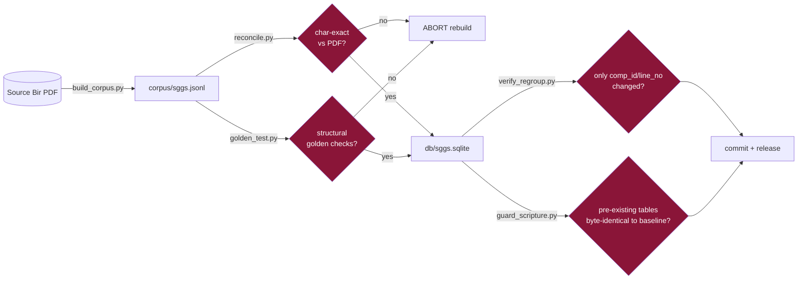

# Scripture Integrity

Textual fidelity is the single most important property of this project and
overrides everything else. The Gurmukhi text is **verbatim** from the source Bir
and is **never** edited, paraphrased, normalized, reordered, or guessed at.

## The guarantee chain



## The only sanctioned text transforms
1. PDF **visual → logical** Unicode reordering of the sihari (`ਿਕ੍ਰਪਾ → ਕ੍ਰਿਪਾ`).
2. Editorial Unicode-repair corrections where the source font emitted impossible
   sequences. The complete register is `audit/editorial-ledger.jsonl` — **4 rules,
   11 applications**: Angs 573, 586, 727 (itemised from the start) and Angs 1354, 1358,
   1387, 1398, 1402, 1406, 1408, 1409 (same `fix_text` step-4 rules; itemised 2026-09-23,
   scholarly review completed and approved 2026-09-24, gate G3). Every decoding transform (timestamps, halant
   order, glyph restorations, vowel re-attachment, stray-character strip) is registered too.

Any new transform must be registered in the ledger and reviewed by a human. The English
translations are a **separate, labelled layer** (Dr. Sant Singh Khalsa via
BaniDB/ShabadOS) and are never blended into the Gurmukhi.

## Proof tools
| Tool | Proves | When |
|---|---|---|
| `pipeline/reconcile.py` | corpus == PDF, character for character | every rebuild (gate) |
| `pipeline/golden_test.py` | canonical structural checks | every rebuild (gate) |
| `pipeline/sggs_integrity.py` | the committed DB's content equals `audit/dataset-fingerprint.json` — every table (build stamps blanked), every FTS5 index (via `fts5vocab`), `scripture_sha256` (the iOS definition) and `t0_sha256`; stable across SQLite versions | every PR (CI gate); written by every rebuild |
| `pipeline/data_quality.py` | the dataset is well formed and the tracked rows are as reviewed: 60,658 lines over Angs 1–1430, no line without a `comp_id` and the set of `comp_id` gaps unchanged (ids are never reused), the heading set unchanged, no Latin in Gurmukhi columns and no Gurmukhi in the English layer, no reference to a missing line, and the 21 isolated-sign lines plus the empty-`translit_norm` line exactly as in `audit/data-quality-baseline.json` | every PR (CI gate); the baseline is re-recorded only in a reviewed PR |
| `pipeline/ledger_check.py` | `fix_text` editorial rules == the ledger; any scripture (T0) change is covered by a new, reviewed ledger entry | every PR (CI gate) |
| `pipeline/line_id_gate.py` | every existing line `id` still names the same (`ang`, `gurmukhi`), byte for byte, in the corpus and the DB; ids are 1..N; new ids only appended and recorded in `audit/line-id-baseline.json` | every PR (CI gate) and every rebuild, before the corpus and the DB are installed |
| `pipeline/hukamnama_contract.py` | the 40 id ranges in `contract/golden_hukamnama.ndjson` hash to their recorded `range_sha256` from the corpus and the DB, and the file is what the script generates | every PR (CI gate) and every rebuild |
| `pipeline/verify_regroup.py` | a corpus change touched only `comp_id`/`line_no`; scripture byte-identical | any PR touching corpus/db |
| `pipeline/timing/guard_scripture.py` | pre-existing tables byte-identical to the committed baseline | after any DB write |
| `validation/reconcile-attestation.json` | the corpus in this commit reconciled char-exact locally (the PDF never enters CI) | `make reconcile` |
| `/api/health` | 60,658 lines, 1,430 Angs, FTS live, verbatim Mool Mantar, ≥560 ੴ, live verify | after any DB change |

## Line ids are permanent addresses
A line's `id` is an address that clients keep: bookmarks, deep links, and the Darbar Sahib Hukamnama
push, which sends the day's shabad as `first_line_id..last_line_id` and lets the phone render those ids
from its own bundled database. `build_corpus.py` numbers lines 1..N in page order, so a line split,
merged, inserted or dropped anywhere would silently move every later id. Invariants:

- **An existing id never changes its (`ang`, `gurmukhi`).** It is never shifted, reused, rewritten or
  removed. `pipeline/line_id_gate.py` holds the corpus and the DB to `audit/line-id-baseline.json`
  (one sha256 per Ang block over `"{id}\t{ang}\t{gurmukhi}\n"`, as last released) and fails the PR
  and the rebuild otherwise. Every id has been stable since the first committed corpus.
- **New lines take new ids at the end** (above the baseline's `max_id`), and the baseline must record
  them (`python3 pipeline/line_id_gate.py --update`, which refuses while any existing id has moved).
- **A sanctioned editorial correction** (a new `audit/editorial-ledger.jsonl` application) changes a
  line's `gurmukhi` and is therefore also a change of that id's text: it is re-baselined explicitly with
  `--update --rebaseline "<ledger id>: <reason>"`, allowed only with a MAJOR `DATASET_VERSION` bump, and
  recorded in the baseline's `rebaselines` history. Clients then see the range hash change and refuse
  the old range rather than draw different text under it.

### The range hash (`range_sha256`)
The one definition, shared by the Hukamnama server, the platform and the iOS app:

```
range_sha256 = lowercase hex sha256 of the UTF-8 bytes of
               "\n".join( NFC(lines.gurmukhi) for id = first_line_id .. last_line_id )
```

- ids ascending, **inclusive at both ends**; every id in the range must exist;
- each line's `gurmukhi` column as stored (with its dandas and markers), Unicode **NFC**-normalised
  (the stored text is already NFC; normalising guards a client whose copy is not);
- joined by a single U+000A, **no trailing newline**, no other separator or whitespace added.

`contract/golden_hukamnama.ndjson` pins it with 40 real ranges — 32 single-Ang shabads, 4 shabads
that cross an Ang, 4 Vaar readings (saloks + the pauri after them) — each a whole composition as
printed, heading lines included: `{kind, first_line_id, last_line_id, ang, range_sha256}`, `ang`
being the first line's. `python3 pipeline/hukamnama_contract.py --write` regenerates it; a client
proves its implementation by reproducing every `range_sha256` from its own database.

## The hash chain
`MANIFEST.json` carries `corpus_sha256` + `db_sha256`; `contract/_meta.json` carries
its own `db_sha256`; the iOS manifest carries `db_sha256` + `scripture_sha256`.
`scripture-integrity` CI asserts these agree, so a DB rebuild that forgets to
regenerate the contract or the attestation fails the gate rather than silently
shipping drift.

## If text looks wrong
**Flag it, do not change it.** Open a *Scripture fidelity concern* issue with the
Ang and the verbatim line; a Granthi/scholar reviews. Known items awaiting review:
the 3 `TRAILING_RUBRICS` (`ਜੁਮਲਾ`, `ਦੁਤੁਕੇ`, `ਏਹੁ ਸਲੋਕੁ ਆਦਿ ਅੰਤਿ ਪੜਣਾ`), ~20
verse lines the source mis-tags as headings, and the source-faithful isolated-matra
rows (Angs ~695–699, 1354/1358/1387).
